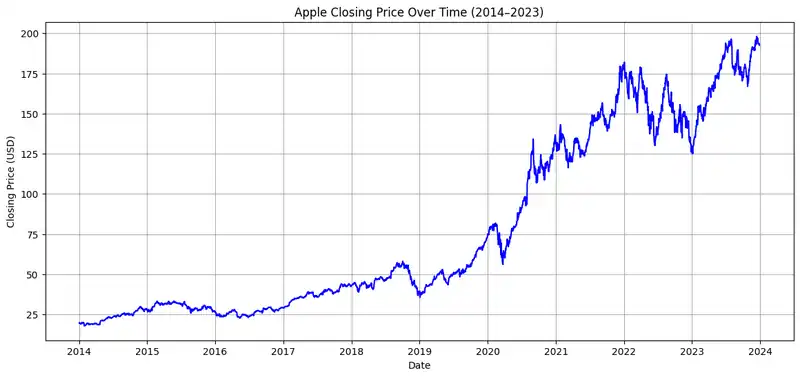
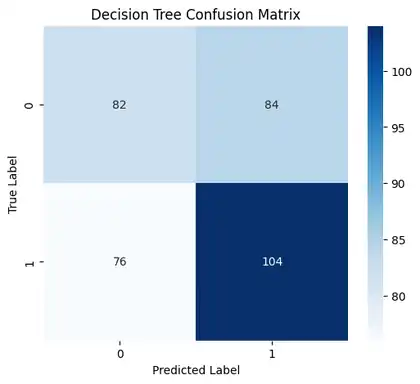
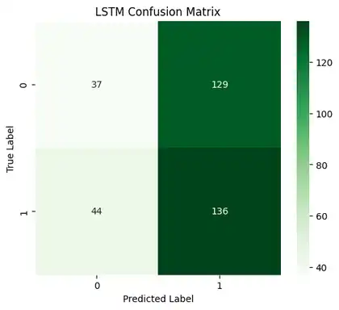
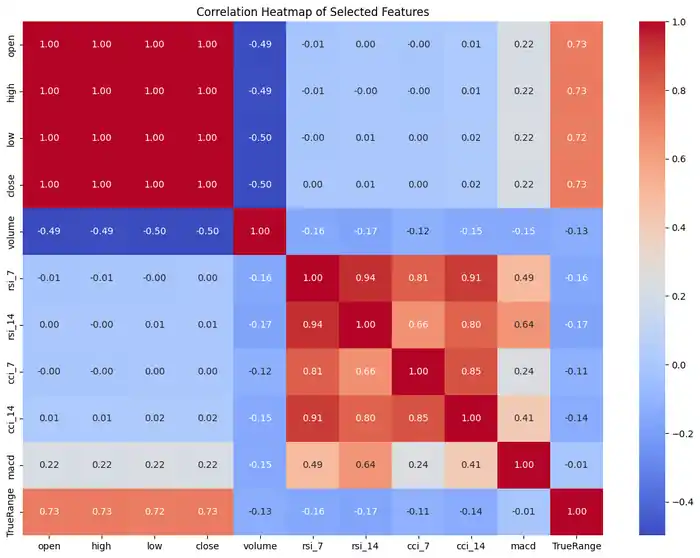
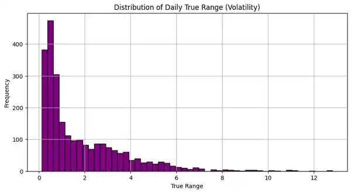

# Stock Market Trend Classification: Decision Tree vs LSTM

Predicting whether Apple (AAPL) stock moves **bullish (1)** or **bearish (0)** using 10 years of daily price data and technical indicators, and comparing a classic machine learning model (Decision Tree) against a deep learning model (LSTM).



## Overview

| | |
|---|---|
| **Dataset** | AAPL daily data, 2014–2023 (2,516 trading days, 20 columns) |
| **Features** | 18: OHLC prices, volume, RSI (7/14), CCI (7/14), SMA & EMA (50/100), MACD, Bollinger, True Range, ATR (7/14) |
| **Target** | Bullish (1) / Bearish (0), with neutral days removed (1,730 rows used) |
| **Models** | Decision Tree (scikit-learn), LSTM (TensorFlow/Keras) |
| **Metrics** | Accuracy, Precision, Confusion Matrix, Classification Report |

## Approach

1. **Data check.** The dataset has no missing values. Neutral targets are dropped so the task is binary classification.
2. **Exploratory data analysis.** Seven charts cover price trend, volatility (True Range, ATR), yearly averages, volume vs price, RSI spread and feature correlation.
3. **Time-aware split.** The data is split 80/20 with `shuffle=False`, so the models train on the past and are tested on the future. A random split would leak future information.
4. **Scaling.** `MinMaxScaler` is fit on the training set only and then applied to the test set.
5. **Decision Tree.** `max_depth=5` limits overfitting.
6. **LSTM.** One LSTM layer with 50 units, then Dropout(0.2), then a sigmoid output. It uses the Adam optimizer and binary cross-entropy loss, and trains for 20 epochs. The input is reshaped to `(samples, 1, 18)`.

## Results

| Model | Accuracy | Precision |
|---|---|---|
| Decision Tree | 53.8% | 55.3% |
| LSTM | 50.0% | 51.3% |

<p float="left">
  
  
</p>

**What this means.** Both models score only a little above a coin flip. That is a realistic result for predicting daily stock direction, which is very noisy. In this run the Decision Tree did slightly better. The LSTM leaned toward predicting "bullish" (recall 0.76 for class 1 vs 0.22 for class 0). LSTM results also change from run to run because its weights start randomly; the script version fixes the random seed so results can be repeated.

### Selected EDA

<p float="left">
  
  
</p>

- The open, high, low and close prices are almost perfectly correlated, so they carry overlapping information.
- RSI and CCI are strongly related to each other.
- Volume has only a weak relationship with price.
- Daily volatility is usually low, with occasional large spikes (for example, early 2020).

## Project Structure

```
stock-trend-classification/
├── notebooks/
│   └── stock_classification.ipynb   # full analysis with commentary and results
├── src/
│   └── stock_classifier.py          # same pipeline as a runnable script (saves all 9 charts)
├── images/                          # charts used in this README
├── data/
│   └── README.md                    # how to get the dataset
├── requirements.txt
└── README.md
```

## How to Run

```bash
git clone https://github.com/azmir9083/machine-learning-projects.git
cd machine-learning-projects/stock-trend-classification
pip install -r requirements.txt

# put aapl_2014_2023.csv in data/ (see data/README.md), then:
python src/stock_classifier.py          # saves charts to outputs/
# or open the notebook:
jupyter notebook notebooks/stock_classification.ipynb
```

## Limitations & Future Work

- With one time step per sample, the LSTM can't use its main strength, which is memory across a sequence of days. A sliding window of 10–30 days is the natural next step.
- Ensemble or stacked models (for example, Random Forest, XGBoost, or a Decision Tree combined with an LSTM).
- Extra signals: news or social media sentiment and macroeconomic indicators.
- Hyperparameter tuning with time-series cross-validation (`TimeSeriesSplit`).

## Tech Stack

Python · pandas · NumPy · Matplotlib · Seaborn · scikit-learn · TensorFlow/Keras · Google Colab

---
*Built as a course project for Introduction to Machine Learning.*
